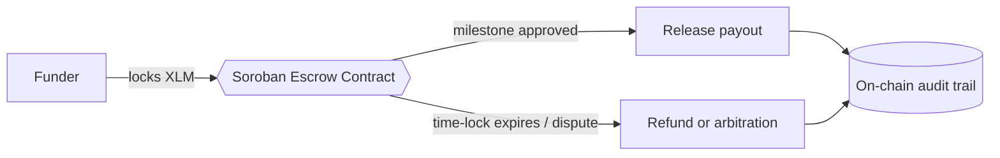
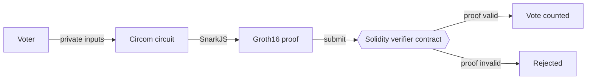

<div align="center">
  
</div>

<div align="center">
  
</div>

<p align="center"><strong>🔱 Origin: Ujjain &nbsp;•&nbsp; Jay Shree Mahakal 🚩</strong></p>

<p align="center">
  <a href="https://www.linkedin.com/in/earth-kumar-roy/"></a>
  <a href="https://x.com/Earth_Kumar_Roy"></a>
  <a href="mailto:earth.kumar.roy9752@gmail.com"></a>
  <a href="https://sites.google.com/view/ekr1/"></a>
  <a href="https://sites.google.com/view/ekr1/leave-a-message"></a>
</p>

<p align="center">
  
  
  
  
</p>


## 🧬 `whoami`

```solidity
// SPDX-License-Identifier: MIT
pragma solidity ^0.8.20;

contract EarthKumarRoy {
    string public role     = "Web3 Developer & Automation Engineer";
    string public focus    = "Trustless, non-custodial infrastructure";
    string[3] public chains = ["Stellar (Soroban)", "Ethereum (EVM)", "Solana"];
    string public privacy  = "Zero-Knowledge Proofs (Groth16 + Circom)";
    string public motto    = "Build for verification, not validation.";
}
```

I build **trustless, non-custodial decentralized systems**, with a core focus on smart contracts across **Stellar Soroban**, **Ethereum** and **Solana**, plus privacy-preserving architectures using **zk-SNARKs**. Beyond Web3, I ship lightweight web tools and automations.

| | |
|---|---|
| 🛡️ **Treasury & Escrow** | Autonomous treasury defense, milestone escrow, time-locks, on-chain arbitration |
| 🔐 **Zero-Knowledge** | Circom circuits, SnarkJS, Groth16 proofs, Poseidon hashing, Solidity verifiers |
| ⛓️ **Multi-chain** | Soroban (Rust) on Stellar, EVM (Solidity) on Ethereum, exploring Solana |
| ⚡ **Automation** | Google Apps Script, REST APIs, browser-based AI tools, Pine Script |


## 🚀 Flagship Web3 Projects

<table>
  <tr>
    <td width="33%" valign="top">
      <h3 align="center">🛡️ Stellar Sentinel</h3>
      <p align="center">
        
        
        
      </p>
      <p>Autonomous treasury defense protocol on Stellar Soroban that reduces corporate disbursement risk through instant non-custodial smart contract escrow and dynamic time-locks.</p>
      <p align="center"><a href="https://github.com/Earth-Kumar-Roy/Stellar-Sentinel"><b>Explore Repo »</b></a></p>
    </td>
    <td width="33%" valign="top">
      <h3 align="center">🌊 StellarFlow V2</h3>
      <p align="center">
        
        
      </p>
      <p>Non-custodial, milestone-based escrow platform on Soroban. Cryptographically enforced, trustless payment management for Web3 teams, with XLM payouts and on-chain audit trails.</p>
      <p align="center"><a href="https://github.com/Earth-Kumar-Roy/StellarFlowV2"><b>Explore Repo »</b></a></p>
    </td>
    <td width="33%" valign="top">
      <h3 align="center">🗳️ ZKBallotChain</h3>
      <p align="center">
        
        
        
      </p>
      <p>Decentralized, privacy-preserving governance dApp on Ethereum Sepolia. Built with Circom, SnarkJS and Solidity, using Groth16 zk-SNARKs and Poseidon hashing for private voting.</p>
      <p align="center"><a href="https://github.com/Earth-Kumar-Roy/ZKBallotChain"><b>Explore Repo »</b></a></p>
    </td>
  </tr>
</table>

<div align="center">
  <a href="https://github.com/Earth-Kumar-Roy/Stellar-Sentinel"></a>
  <a href="https://github.com/Earth-Kumar-Roy/StellarFlowV2"></a>
  <a href="https://github.com/Earth-Kumar-Roy/ZKBallotChain"></a>
</div>

### 🧩 How they work (conceptual)

<details>
<summary><b>🌊 Milestone escrow flow (StellarFlow / Stellar Sentinel)</b></summary>



</details>

<details>
<summary><b>🗳️ Private voting flow (ZKBallotChain)</b></summary>



</details>


## ⛓️ More Blockchain Work

| Project | What it does | Stack |
|---|---|---|
| [**StellarFlow**](https://github.com/Earth-Kumar-Roy/StellarFlow) | Non-custodial milestone escrow with automated XLM payouts, on-chain audit trails and multi-party notifications | Soroban |
| [**SorobanEscrowHub**](https://github.com/Earth-Kumar-Roy/SorobanEscrowHub) | Decentralized P2P milestone escrow and arbitration dApp | Soroban |
| [**stellar-poll**](https://github.com/Earth-Kumar-Roy/stellar-poll) | Real-time polling dApp with multi-wallet support and live vote sync | Soroban |
| [**stellar-pay**](https://github.com/Earth-Kumar-Roy/stellar-pay) | Web3 payment dApp on Stellar Testnet | JavaScript |
| [**EKR-Bulk-Freighter-Wallet-Generator**](https://github.com/Earth-Kumar-Roy/EKR-Bulk-Freighter-Wallet-Generator) | Multi-account tooling for Stellar developers to measure traction and stress-test high-volume contract transactions | TypeScript |


## 🛠️ Tech Stack

#### ⛓️ Blockchain & Zero-Knowledge
<p>
  
  
  
  
  
  
  
  
  
  
</p>

#### 💻 Languages
<p>
  
  
  
  
  
  
  
  
  
  
</p>

#### 🧱 Frameworks & Libraries
<p>
  
  
  
  
  
  
</p>

#### ☁️ Databases, Cloud & Automation
<p>
  
  
  
  
  
  
  
  
  
</p>


## ⚡ Tools, Automation & AI

<details>
<summary><b>Open the toolbox (web tools, automation, browser AI)</b></summary>
<br/>

| Project | Description |
|---|---|
| [**AI-Realtime-Face-Detecting-Attendance-System**](https://github.com/Earth-Kumar-Roy/AI-Realtime-Face-Detecting-Attendance-System) | Browser-based biometric attendance using Face-API.js and Google Apps Script |
| [**AI-Facial-Identity-Matching-System**](https://github.com/Earth-Kumar-Roy/AI-Facial-Identity-Matching-System) | Identity verification in the browser with face-api.js and TensorFlow.js |
| [**Smart-Waste-Report-Management-App**](https://github.com/Earth-Kumar-Roy/Smart-Waste-Report-Management-App) | Citizen waste reporting with images and location, plus field worker resolution |
| [**Waste-Reporting-and-Redressal-System**](https://github.com/Earth-Kumar-Roy/Waste-Reporting-and-Redressal-System) | Worker registration with ID verification, admin approval and automated emails |
| [**Mass-Email-Sender**](https://github.com/Earth-Kumar-Roy/Mass-Email-Sender) | Bulk email tool on Google Apps Script and Tailwind CSS |
| [**User-Registration**](https://github.com/Earth-Kumar-Roy/User-Registration) | Duplicate-safe registration form using Google Sheets as backend |
| [**AppScript-Drive-Spreadsheet**](https://github.com/Earth-Kumar-Roy/AppScript-Drive-Spreadsheet) | Apps Script utilities for Sheets, Drive uploads and dashboards |
| [**Canvas-PDF-to-HTML**](https://github.com/Earth-Kumar-Roy/Canvas-PDF-to-HTML) | Browser-based PDF to HTML converter built on PDF.js |
| [**Base64-Encoder-Decoder**](https://github.com/Earth-Kumar-Roy/Base64-Encoder-Decoder) | Compact Base64 tool for text and files |
| [**AC-Gen.-Faradays-Lenz**](https://github.com/Earth-Kumar-Roy/AC-Gen.-Faradays-Lenz) | Interactive physics simulation on HTML5 Canvas |
| [**Image-classification-ML**](https://github.com/Earth-Kumar-Roy/Image-classification-ML) | Python client for image prediction REST APIs with latency measurement |

</details>


## 📊 GitHub Stats & Contributions

<div align="center">
  
</div>

<br/>

<div align="center">
  
  
</div>

<br/>

<div align="center">
  
</div>

<br/>

<div align="center">
  
</div>

<br/>

<div align="center">
  
</div>


## 🎯 Currently

- 🔭 Building trustless escrow and treasury protocols on **Stellar Soroban**
- 🔐 Going deeper into **zero-knowledge** circuits and on-chain verifiers
- 🌞 Exploring **Solana** programs alongside EVM and Soroban
- 🤝 Open to collaborating on **Web3, ZK and smart contract security** projects

## 📬 Get In Touch

<div align="center">
  <table border="0">
    <tr>
      <td align="center"><a href="https://sites.google.com/view/ekr1/leave-a-message"></a></td>
      <td align="center"><a href="https://www.linkedin.com/in/earth-kumar-roy/"></a></td>
      <td align="center"><a href="https://x.com/Earth_Kumar_Roy"></a></td>
    </tr>
  </table>
  <br/>
  <a href="mailto:earth.kumar.roy9752@gmail.com"></a>
  &nbsp;
  <a href="https://sites.google.com/view/ekr1/"></a>
  <br/><br/>
  <i>"Code without trust assumptions. Build for verification, not validation."</i>
  <br/><br/>
  
</div>
