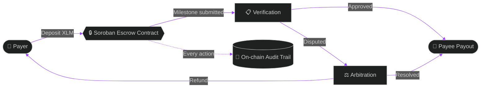
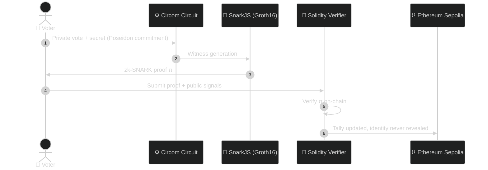

<!-- ═══════════════════════════════════════════════════════════════
     EARTH KUMAR ROY · Web3 Profile README
     Place this file at: github.com/Earth-Kumar-Roy/Earth-Kumar-Roy/README.md
     ═══════════════════════════════════════════════════════════════ -->

<div align="center">


<br/>

**🔱 Origin: Ujjain · Jay Shree Mahakal 🚩**

<br/>

<a href="https://www.linkedin.com/in/earth-kumar-roy/"></a>
<a href="https://x.com/Earth_Kumar_Roy"></a>
<a href="mailto:earth.kumar.roy9752@gmail.com"></a>
<a href="https://sites.google.com/view/ekr1/"></a>
<a href="https://sites.google.com/view/ekr1/leave-a-message"></a>

<br/><br/>


</div>

<br/>


## 🌌 &nbsp;About Me

<table>
<tr>
<td width="62%" valign="top">

I build **trustless, non-custodial infrastructure**: systems where the code enforces the rules, so nobody has to be trusted.

My work centres on smart contract engineering across **Stellar (Soroban)**, **Ethereum (EVM)** and **Solana**, and on **zero-knowledge cryptography** for privacy-preserving governance.

- 🛡️ **Treasury & escrow defense:** milestone-based, time-locked, arbitrated payments
- 🔐 **ZK architectures:** Circom circuits, Groth16 proofs, Poseidon hashing, on-chain verifiers
- ⚡ **Automation & tooling:** lightweight web tools, Apps Script pipelines, wallet utilities for developers
- 🧠 **AI enthusiast:** on-device ML, face-api.js, TensorFlow.js, anomaly detection

</td>
<td width="38%" valign="top">

```ts
const earth = {
  role:    "Web3 Developer",
  chains:  ["Stellar", "Ethereum", "Solana"],
  focus:   ["Smart Contracts", "ZK-SNARKs"],
  stack:   ["Rust", "Solidity", "TypeScript"],
  mantra:  "Verify, don't trust.",
  openTo:  ["Collabs", "Hackathons", "Grants"],
} as const;
```

</td>
</tr>
</table>

<br/>

## ⛓️ &nbsp;Chain Arsenal

<div align="center">
<table>
<tr>
<td align="center" width="33%">
<br/><br/>
<sub>Rust smart contracts<br/>Freighter wallet · XLM payouts<br/>Escrow &amp; treasury protocols</sub>
</td>
<td align="center" width="33%">
<br/><br/>
<sub>Solidity · Sepolia deployments<br/>On-chain Groth16 verifiers<br/>ZK governance dApps</sub>
</td>
<td align="center" width="33%">
<br/><br/>
<sub>Rust programs<br/>High-throughput design<br/>Actively exploring</sub>
</td>
</tr>
</table>
</div>

<br/>

## 🚀 &nbsp;Flagship Projects

<table>
<tr>
<td width="33%" valign="top">

<h3 align="center">🛡️ Stellar Sentinel</h3>

<p align="center">


</p>

An **autonomous treasury defense protocol** on Soroban that eliminates corporate disbursement risk through instant non-custodial escrow and dynamic time-locks.

<p align="center"><a href="https://github.com/Earth-Kumar-Roy/Stellar-Sentinel"></a></p>

</td>
<td width="33%" valign="top">

<h3 align="center">🌊 StellarFlow V2</h3>

<p align="center">


</p>

A **milestone-based escrow platform** with cryptographically enforced, trustless payment management, automated XLM payouts and on-chain audit trails.

<p align="center"><a href="https://github.com/Earth-Kumar-Roy/StellarFlowV2"></a></p>

</td>
<td width="33%" valign="top">

<h3 align="center">🗳️ ZKBallotChain</h3>

<p align="center">


</p>

A **privacy-preserving governance dApp**: Circom circuits, SnarkJS proofs, Poseidon hashing and Solidity verifiers enable private, verifiable voting.

<p align="center"><a href="https://github.com/Earth-Kumar-Roy/ZKBallotChain"></a></p>

</td>
</tr>
</table>

<br/>

### 🧬 &nbsp;How They Work

<details open>
<summary><b>🌊 Milestone Escrow Flow (StellarFlow / Stellar Sentinel)</b></summary>



</details>

<details open>
<summary><b>🗳️ Zero-Knowledge Voting Flow (ZKBallotChain)</b></summary>



</details>

<br/>

## 🧪 &nbsp;More Web3 Builds

<div align="center">

| Project | Chain | What it does |
|:--|:--:|:--|
| [**SorobanEscrowHub**](https://github.com/Earth-Kumar-Roy/SorobanEscrowHub) |  | Decentralized P2P milestone escrow &amp; arbitration dApp |
| [**StellarFlow**](https://github.com/Earth-Kumar-Roy/StellarFlow) |  | V1 escrow with automated XLM payouts and multi-party notifications |
| [**stellar-poll**](https://github.com/Earth-Kumar-Roy/stellar-poll) |  | Real-time polling dApp with multi-wallet support and live vote sync |
| [**stellar-pay**](https://github.com/Earth-Kumar-Roy/stellar-pay) |  | Modern Web3 payment dApp on Stellar Testnet |
| [**EKR-Bulk-Freighter-Wallet-Generator**](https://github.com/Earth-Kumar-Roy/EKR-Bulk-Freighter-Wallet-Generator) |  | Multi-account generator to test traction and high-volume contract calls |

</div>

<details>
<summary><b>🔬 Beyond Web3: AI, security &amp; automation</b></summary>

<br/>

- 🧑‍💻 **AI-Realtime-Face-Detecting-Attendance-System:** face recognition attendance with Face-API.js and Apps Script
- 🪪 **AI-Facial-Identity-Matching-System:** browser-based biometric verification with face-api.js and TensorFlow.js
- ♻️ **Smart-Waste-Report-Management-App / Waste-Reporting-and-Redressal-System:** civic issue tracking with admin workflows
- 📧 **Mass-Email-Sender:** bulk mailer on Google Apps Script and Tailwind CSS
- ⚡ **AC-Gen. Faraday's-Lenz:** interactive Class 12 physics simulation on HTML5 Canvas
- 🔤 **Base64-Encoder-Decoder** · 📄 **Canvas-PDF-to-HTML** · 📝 **User-Registration** · 💬 **EKR-LLD-Chatting-App**
- 🔒 *Private builds (SIH):* a legal metrology verification portal and a SOC assessment platform with Isolation Forest anomaly classification

</details>

<br/>

## 🛠️ &nbsp;Tech Stack

#### ⛓️ Blockchain &amp; Zero-Knowledge

<p>


</p>

#### 💻 Languages

<p>


</p>

#### 🧩 Frameworks &amp; Libraries

<p>


</p>

#### ☁️ Databases, Cloud &amp; Automation

<p>


</p>

<br/>

## 📊 &nbsp;GitHub Stats &amp; Contributions

<div align="center">


<br/><br/>


<br/><br/>


<br/><br/>


<br/><br/>

<!-- 3D contribution skyline: needs the optional workflow described in the setup notes.
     Uncomment once profile-3d-contrib/profile-night-rainbow.svg exists in your profile repo. -->
<!--

-->

<!-- Snake animation: needs the optional workflow described in the setup notes.

-->

</div>

<br/>

## 🧭 &nbsp;Roadmap

```diff
+ Shipping    : Soroban escrow & treasury protocols (Stellar Sentinel, StellarFlow V2)
+ Shipped     : ZK voting on Ethereum Sepolia with Groth16 verifiers
! In progress : Deeper Solana (Rust programs), more ZK circuits
# Next        : Cross-chain proofs, formal verification, security audits
```

<br/>

## 🎯 &nbsp;Currently

<div align="center">


</div>

<br/>

## 📬 &nbsp;Let's Build Something Trustless

<div align="center">

<a href="https://sites.google.com/view/ekr1/leave-a-message"></a>
<a href="https://www.linkedin.com/in/earth-kumar-roy/"></a>
<a href="https://x.com/Earth_Kumar_Roy"></a>
<a href="mailto:earth.kumar.roy9752@gmail.com"></a>

<br/><br/>


</div>
